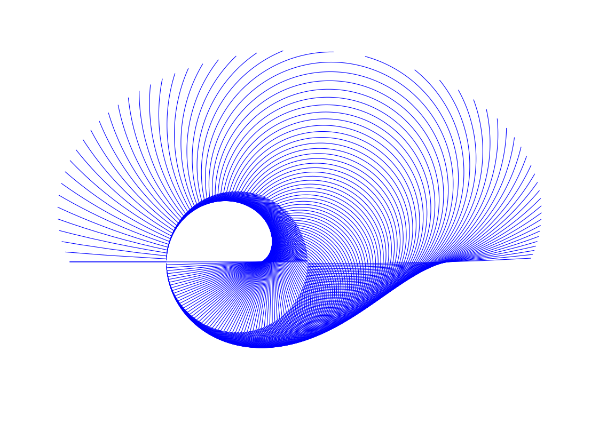
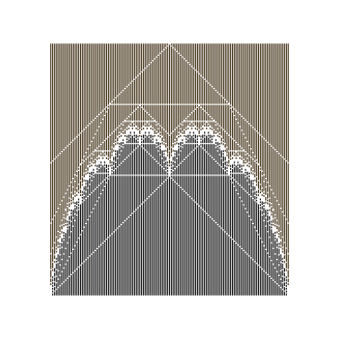

# pen-plot-sketch

A collection of generative pen-plotter sketches and shared support libraries.
Most sketches are built with either [vsketch](https://github.com/abey79/vsketch)
(Python) or [whiskers](https://github.com/abey79/whiskers) (Rust); each gives a
live parameter GUI and SVG output ready for a plotter.

## Sketches

Each folder below has its own README with full parameter docs. The `Preview`
column links to a sample render collected in [`reference/`](reference/).

| Preview | Sketch | Framework | What it draws |
|---------|--------|-----------|---------------|
|  | [boxes](boxes/) | vsketch | Recursively subdivides a rectangle (randomised guillotine split) and fills each box with solid / hatch / glyph patterns. Doubles as the testbed for the `penfill` library. |
|  | [crack](crack/) | vsketch | A solid-fill spin-off of `boxes`: guillotine-split shards coloured per side, with a jagged crack deleted from the top edge to the bottom edge (widening when it runs long). |
| | [floorplan](floorplan/) | vsketch | Procedurally generated Minoan-ruin mazes, voxelised and eroded into ruins, rendered as isometric pen plots (optionally on a noise terrain). |
|  | [L-Systems](L-Systems/) | vsketch | Grows L-systems (Lindenmayer systems) from rewrite rules and draws them with a turtle; presets for classic fractals and branching plants. |
|  | [lovecraftian gasket](lovecraftian%20gasket/) | vsketch | Fills an Apollonian circle packing and renders each circle as a manga-style eye or a tooth-studded orifice, with a CMA-ES arrangement search. |
|  | [modulo_multiplication](modulo_multiplication/) | vsketch | Times-table / modular-multiplication chord patterns on a circle (cardioids, roses), plus a comparison grid and a Voronoi-of-intersections variant. |
| | [rolling_circles](rolling_circles/) | whiskers (Rust) | Traces the curve of a pen on the last of a chain of circles rolling without slipping — epitrochoids generalised from two circles to N. |
|  | [tree-rings](tree-rings/) | whiskers (Rust) | Grows procedural tree-ring cross-sections via Perlin-modulated growth and relaxation, tiled across a squared dissection of the page. |
|  | [Takagi](Takagi/) | vsketch | Draws the Takagi (blancmange) function and variants, one iteration per layer. |
| | [Phonograph](Phonograph/) | — | Planned: turn a `.WAV` into a spiral plot of its waveform to resemble a phonograph record (README only, not yet implemented). |

## Libraries

Shared modules used by the sketches above.

- **[penfill](penfill/)** — Composable polygon fills for vsketch / vpype.
  Patterns (solid, hatch, glyph grids) return a geometry IR instead of drawing
  directly, so fills are cacheable and composable across layers/colours; also
  handles pen-config loading. Used by `boxes`, `isometric`,
  `modulo_multiplication`, `floorplan`, and `lovecraftian gasket`.
- **[isometric](isometric/)** — True 30° isometric rendering of integer voxels
  with exact per-triangle hidden-surface removal and per-face `penfill` fills;
  every function returns the penfill geometry IR. Includes a vsketch testbed
  (`sketch_isobox.py`). Used by `floorplan`.
- **[tools](tools/)** — Standalone utilities. Currently
  `drawingbot_to_vpype.py`, which converts DrawingBot pen presets into
  vpype / penfill pen-config TOMLs.

## TODO — folders without a README

Undocumented yet; noted here so they don't get lost.

- **PenLayerTest** — vsketch — pen / layer test sketch.
- **PlotterTest** — vsketch — plotter test sketch.
- **Random_Takagi** — vsketch — randomised Takagi variant.
- **asemic-writing** — whiskers (Rust workspace: `asemic-core`, `glyph-editor`, `word-composer`) — generative asemic glyphs / writing.
- **complex_dynamics** — whiskers (Rust) — complex-dynamics external/internal rays, laminations, and a PCF finder.
- **epitrochiod** — whiskers (Rust) — epitrochoid / hypotrochoid curves.
- **grid** — Rust library — exhaustive squared-square dissection search (used by `tree-rings` for tiling).
- **pens** — data — shared vpype / DrawingBot pen-config TOMLs consumed via `penfill.load_pens`.

## Ideas

* Space filling curves for half-toning, randomize substitition
* Monochrome CRT filter with scan lines, shadow mask and distortion caused by the shape of the CRT. Input would be an already half-toned BW image.
